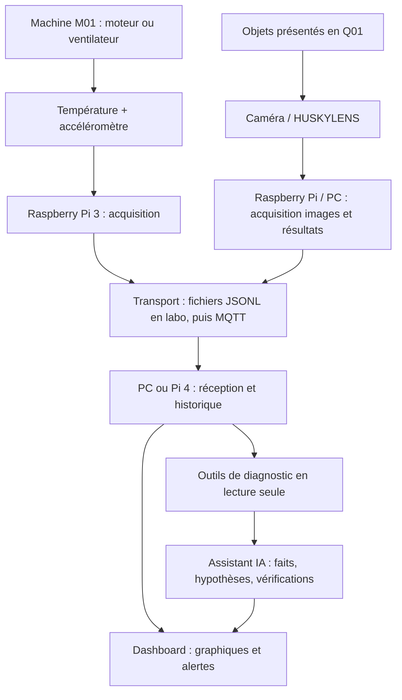

# FactoryPulse 🏭

**Plateforme pédagogique de supervision industrielle, d'inspection visuelle et d'assistance au diagnostic par IA**

> **En une phrase :** transformer des équipements ordinaires en postes connectés, collecter leurs données, repérer les anomalies, contrôler des objets et aider un opérateur à comprendre ce qui se passe.

| Fiche projet | Détails |
|---|---|
| **Nom** | FactoryPulse |
| **Domaine** | Industrie 4.0, IoT, supervision, vision artificielle, maintenance assistée |
| **Nature** | Prototype pédagogique, non destiné à piloter une vraie installation industrielle |
| **Organisation** | 3 équipes de 3 à 4 personnes, un monorepo Git partagé |
| **Langage principal** | Python |
| **Développement initial** | Sur PC, à partir de données simulées ; intégration matérielle ensuite |
| **Architecture logicielle** | Monolithe modulaire dans un seul dépôt, exécutable sur plusieurs équipements |

---

## 1. Le problème que nous voulons résoudre

De nombreuses machines et installations produisent des informations utiles, mais elles ne disposent pas toujours d'une supervision centralisée. Une vibration inhabituelle, une hausse de température, une inspection non conforme ou un capteur indisponible peuvent passer inaperçus ou être difficiles à interpréter.

FactoryPulse cherche à démontrer une approche simple : **connecter → collecter → contextualiser → détecter → expliquer**.

L'enjeu n'est pas de multiplier les graphiques ou de placer de l'IA partout. Chaque élément doit contribuer à une décision compréhensible : **que se passe-t-il, sur quel équipement, sur quelles données se base-t-on, et que faudrait-il vérifier ?**

## 2. La démonstration finale recherchée

Deux postes représentent une petite ligne de production :

**M01 — Surveillance machine.** Un moteur ou un ventilateur fonctionne pendant que des capteurs relèvent sa température et ses accélérations. Le système calcule des indicateurs de vibration, enregistre l'état du poste et détecte un comportement inhabituel. Une anomalie mesurée ne constitue pas, à elle seule, la preuve d'une panne mécanique.

**Q01 — Inspection visuelle.** Une caméra observe des objets présentés dans une zone définie. YOLO identifie les objets reconnaissables ; OpenCV peut vérifier une pastille de couleur ; le HUSKYLENS, selon son modèle et son mode, peut fournir une observation complémentaire. Une règle pédagogique classe chaque inspection `PASS`, `REJECT` ou `UNKNOWN`.

**Supervision.** Un tableau de bord affiche les mesures, les états, les contrôles et les événements. Un assistant IA peut consulter ces informations pour **expliquer** un incident, mais n'est pas autorisé à commander directement un moteur ni à modifier une machine.

### Scénario concret

1. Un opérateur lance une session de démonstration.
2. M01 transmet température, vibration et état de la machine.
3. Q01 analyse quelques objets, conserve leurs résultats et compte les **inspections uniques**.
4. Une variation de fonctionnement provoque une alerte si elle dépasse les règles calibrées.
5. Le tableau de bord montre les mesures et l'historique associé.
6. L'opérateur interroge l'agent : **« Pourquoi M01 est-elle en alerte ? »**
7. L'agent présente les faits observés, les identifiants des événements qui les prouvent, des hypothèses et des vérifications possibles.

Les mesures simulées sont toujours identifiées comme telles. Le ventilateur **ne fabrique pas physiquement** les objets inspectés : les deux postes illustrent des fonctions distinctes d'une usine.

## 3. Matériel à notre disposition

| Matériel annoncé | Usage envisagé |
|---|---|
| Environ **10 Raspberry Pi 3B** | Nœuds de collecte et d'acquisition des capteurs |
| **2 Raspberry Pi 4B** | Passerelle, broker MQTT, station d'inspection ou serveur de proximité |
| **PC disponibles** | Développement, YOLO, dashboard, stockage, Codex |
| **Accéléromètre** | Mesure des accélérations X/Y/Z puis indicateur de vibration |
| **Plusieurs capteurs de température** | Suivi thermique de M01 |
| **Petit moteur et ventilateur** | Banc de démonstration mécanique à basse tension |
| **Détecteur infrarouge de mouvement** | Détection de mouvement ou de présence **selon sa référence exacte** |
| **Kit HUSKYLENS** | Vision embarquée, à confirmer après inventaire du contenu et test de connexion |
| **Résistances, rack et accessoires** | Raccordement électrique et implantation physique |

**Points à vérifier avant câblage :** modèles exacts des capteurs, interfaces (I²C, 1-Wire, GPIO…), niveaux électriques, alimentations, câbles et références des caméras. Un **PIR** de détection de mouvement n'est **pas** une barrière de passage capable de compter chaque objet. Un comptage physique fiable nécessitera une barrière appropriée ou un autre déclencheur validé ; en attendant, le labo compte les inspections enregistrées.

> Les tâches de vision lourdes (YOLO) sont prévues sur **PC**, plutôt que d'imposer leur exécution en temps réel sur les Pi 3B.

## 4. Architecture générale



**Deux phases sont volontairement séparées :**

- **Phase laboratoire sur PC :** fichiers CSV/JSONL fournis, simulateur machine, YOLO sur photos, dashboard lisant des fixtures. Aucun capteur ni MQTT n'est indispensable pour commencer.
- **Phase intégration physique :** véritables lectures de capteurs, caméra/HUSKYLENS, échange MQTT sur réseau local, persistance et diagnostic sur événements réels.

**MQTT** transporte les événements entre équipements ; **Mosquitto** pourra servir de broker. Il ne réalise ni vision artificielle, ni détection d'anomalies. La sauvegarde en base pourra ensuite être assurée par SQLite.

## 5. Les trois équipes

### Équipe 1 — `monitoring/` : connaître l'état de la machine

**Question métier :** comment distinguer une machine normale, une anomalie et un capteur indisponible ?

- **Entrées du labo :** `data/inputs/machine.csv` (300 mesures simulées) ; `data/inputs/acceleration_xyz.csv` pour l'exercice facultatif sur les vibrations.
- **Outils :** Python, CSV/JSON, calculs statistiques simples, tests unitaires.
- **Fonctions à développer :** simulation, indicateur de vibration RMS dynamique, règles de persistance des dépassements, traitement des valeurs manquantes, export d'événements.
- **Sortie :** fichier JSONL de télémétrie M01 au contrat commun, avec état machine, qualité de mesure, alerte et provenance.
- **Après le distanciel :** remplacer les valeurs simulées par les données réelles de l'accéléromètre et des sondes de température.

**Réussite :** un dépassement durable déclenche une alerte ; un pic isolé et une mesure absente sont traités différemment.

### Équipe 2 — `vision/` : inspecter des objets

**Question métier :** comment identifier des objets et documenter un contrôle visuel reproductible ?

- **Entrées du labo :** `data/inputs/prises_de_vue.csv` décrit **six photos à réaliser** par les étudiants ; les images ne sont pas fournies dans le dépôt.
- **Outils :** Python, Ultralytics YOLO sur PC, OpenCV, images JPG/PNG.
- **Fonctions à développer :** détection, image annotée, score de confiance réel, contrôle d'une pastille verte/rouge, décision `PASS`/`REJECT`/`UNKNOWN`.
- **Sortie :** événements JSONL Q01 et images annotées, sans comptage multiple d'une même inspection.
- **Après le distanciel :** tester une caméra et le HUSKYLENS, puis associer l'observation visuelle à un passage physique fiable.

**Réussite :** le programme reconnaît des exemples valides et gère aussi les cas inconnus ou ambigus sans inventer de résultat.

### Équipe 3 — `dashboard/` : rendre les données exploitables

**Question métier :** comment permettre à un opérateur de comprendre l'état de plusieurs postes ?

- **Entrées du labo :** `data/fixtures/m01.jsonl`, `q01.jsonl`, `systeme.jsonl` et `logs.jsonl`.
- **Outils :** Python, Streamlit, pandas, lecture JSONL.
- **Fonctions à développer :** graphiques de température/vibration, états `RUNNING`/`STOPPED`/`UNKNOWN`, historique d'alertes, compteurs d'inspections, qualité des données et santé des services.
- **Sortie :** application web locale, ainsi que fonctions de consultation réutilisables par l'assistant.
- **Après le distanciel :** brancher le dashboard sur des messages MQTT réels et leur stockage.

**Réussite :** les événements sont visibles, les erreurs sont distinguées des arrêts normaux et les doublons d'inspection ne gonflent pas les compteurs.

### Module transversal — `agent/` : assistant de diagnostic

**Question métier :** face à une alerte, comment produire une explication vérifiable plutôt qu'une supposition ?

- **Entrées :** mesures M01, inspections Q01, états des services, logs et procédures autorisées.
- **Outils de lecture envisagés :** `get_status`, `get_history`, `get_logs`, `get_inspections`.
- **Sortie :** résumé, faits avec références aux événements, hypothèses, vérifications conseillées et limites.
- **Évolution :** exposer ces fonctions par **MCP** pour qu'un agent compatible puisse les interroger ; cela ne se fait pas automatiquement en installant Codex.

**Deux rôles à ne pas confondre :**

1. **Codex dans VS Code** aide les étudiants à comprendre, développer et tester le dépôt en tenant compte des fichiers `AGENTS.md`.
2. **L'assistant FactoryPulse** est une fonctionnalité de diagnostic à construire. Il consulte des outils définis et autorisés ; une surveillance automatique nécessitera aussi un déclencheur d'alertes et un service dédié.

L'agent commence **en lecture seule**. Pas d'accès administrateur général au réseau, pas de commande libre, pas de redémarrage de service ni de pilotage matériel. Si un modèle externe est utilisé, vérifier quelles données peuvent lui être envoyées.

## 6. Contrat de données commun

Tout le système partage le contrat **FP-LAB-1.1**, décrit dans [`docs/DATA_CONTRACT.md`](docs/DATA_CONTRACT.md).

- **CSV** pour les données d'entrée : UTF-8, virgule comme séparateur, première ligne d'en-têtes.
- **JSONL** pour les événements : un objet JSON par ligne, UTF-8.
- **Dates** au format ISO 8601 en UTC (`Z`).
- **Unités** : température en °C, vibration RMS dynamique en `g`.
- **Valeurs absentes** : `null`, jamais zéro inventé.
- **Identifiants** uniques ; une réémission d'un événement garde le même identifiant.
- **Provenance** obligatoire : `simulated`, `physical_sensor` ou `camera_analysis` selon le traitement réellement effectué.

Exemple fictif :

```json
{
  "event_id": "M01-000001",
  "timestamp_utc": "2026-10-12T10:00:00Z",
  "station_id": "M01",
  "event_type": "telemetry",
  "source": "simulated",
  "payload": {
    "temperature_c": 32.5,
    "vibration_rms_g": 0.08,
    "machine_state": "RUNNING",
    "data_quality": "OK",
    "alert_level": "OK",
    "alert_reason": null
  }
}
```

**Règles pédagogiques du laboratoire** (à ne pas interpréter comme des seuils industriels universels) : température supérieure à **60 °C** ou vibration supérieure à **0,20 g RMS** sur **trois mesures consécutives**, espacées d'au plus **1,5 seconde** ; retour à l'état normal après trois mesures valides sous les seuils. Une mesure manquante provoque `DATA_ISSUE` et remet à zéro les compteurs. Les détails font foi dans `docs/DATA_CONTRACT.md` et `config/factorypulse.json`.

Pour le replay, la fraîcheur des données se calcule par rapport à **l'heure de simulation choisie**, et non à la vraie heure du PC.

## 7. Organisation du dépôt et travail collaboratif

```text
factorypulse/
├── AGENTS.md                 # Consignes globales pour Codex
├── README.md                 # Installation et prise en main
├── pyproject.toml            # Dépendances et packaging Python
├── docs/                     # Architecture, contrat, consignes, procédures
├── config/                   # Paramètres et seuils pédagogiques
├── data/
│   ├── inputs/               # CSV de départ
│   ├── fixtures/             # Événements d'exemple versionnés
│   ├── images/               # Photos d'essai
│   └── outputs/              # Résultats locaux non versionnés
├── src/factorypulse/
│   ├── shared/               # Modèles et validateurs communs
│   ├── monitoring/           # Équipe 1 + AGENTS.md
│   ├── vision/               # Équipe 2 + AGENTS.md
│   ├── dashboard/            # Équipe 3 + AGENTS.md
│   ├── agent/                # Diagnostic IA + AGENTS.md
│   └── transport/            # MQTT + AGENTS.md
├── tests/                    # Tests automatisés
├── scripts/                  # Utilitaires
└── .github/                  # CI et Pull Requests
```

**Règles de collaboration :** une branche par fonctionnalité, Pull Request vers `main`, revue croisée, tests avant fusion. Le dossier `shared/` et le contrat de données ne doivent pas être modifiés unilatéralement. Les fichiers `AGENTS.md` aident Codex à respecter les responsabilités de chaque module.

### Démarrage rapide sur PC

```bash
python -m pip install -e ".[dev]"
python scripts/validate_contract.py
python -m pytest
```

Pour la vision et le dashboard, installer les extras correspondants :

```bash
python -m pip install -e ".[vision,dev]"
python -m pip install -e ".[dashboard,dev]"
python -m streamlit run src/factorypulse/dashboard/app.py
```

Créer un environnement virtuel avant installation ; les commandes ci-dessus sont à lancer depuis la racine du dépôt. Les fonctionnalités matérielles et les connecteurs IA ne sont **pas encore implémentés** dans le starter.

## 8. Périmètre et priorités

| Priorité | Résultat visé |
|---|---|
| **1 — Socle** | Simulateur M01, vision sur photos, JSONL cohérents, dashboard de replay |
| **2 — Intégration** | Lecture de vrais capteurs, caméra/HUSKYLENS testés, communications MQTT et historique |
| **3 — Intelligence** | Diagnostics d'incidents fondés sur mesures et logs, outils de consultation en lecture seule |
| **Bonus** | Coûts estimés de production, reprise après panne réseau, comparaison de modèles, déploiement multi-Raspberry |

**Hors périmètre de la première version :** commande autonome de machines, prédiction certifiée des pannes, contrôle qualité industriel homologué, sécurité fonctionnelle, gestion complète d'une vraie usine.

## 9. Comment évaluer si le projet fonctionne

Les équipes devront démontrer, et non simplement affirmer :

- **Surveillance :** une surchauffe et une vibration anormale sont reconnues selon les règles ; une mesure absente n'est pas interprétée comme zéro.
- **Vision :** des images annotées et un résultat structuré sont produits ; les objets inconnus restent `UNKNOWN`.
- **Dashboard :** les données M01/Q01 sont lisibles ; les inspections ne sont pas comptées deux fois.
- **Diagnostic :** une explication d'alerte cite des événements existants et distingue faits, hypothèses et limites.
- **Fiabilité :** un programme déconnecté et une machine volontairement arrêtée ne sont pas confondus.
- **Traçabilité :** données simulées et données physiques sont identifiables ; les tests et résultats sont conservés.

### Livrables attendus

Chaque équipe fournit **du code exécutable**, un exemple de sortie conforme au contrat, des tests et des instructions de lancement. Le groupe livre un dépôt Git documenté, un dashboard et une démonstration de bout en bout avec ses limites connues.

## 10. La vision à plus long terme

FactoryPulse pourrait évoluer vers une petite plateforme de **retrofit industriel** : brancher de nouveaux capteurs et équipements sans réécrire toute l'application, centraliser leurs données et fournir des diagnostics contextualisés. Cette orientation rejoint les sujets de connectivité OT/IT, de supervision et d'exploitation des données industrielles discutés autour de **Magnet Group**.

**Notre ambition pour ce labo :** une démonstration modeste, fiable et explicable, plutôt qu'une IA spectaculaire mais impossible à vérifier.

---

*Document de présentation. Les références matérielles exactes, seuils définitifs et contraintes de déploiement devront être validés lors de l'intégration physique.*
