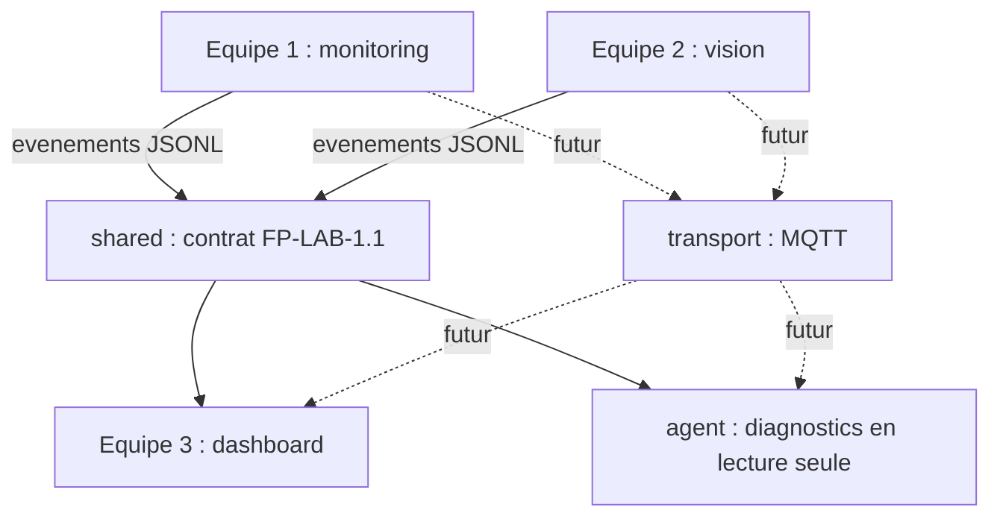

# Architecture du monorepo

**Un dépôt Git ; des modules métier séparés.** En distanciel, tout fonctionne en lecture de fichiers. En présentiel, les adaptateurs Raspberry et le transport MQTT remplaceront progressivement les entrées de simulation.

## Responsabilités

- `monitoring` : acquisitions virtuelles/réelles, RMS et seuils, M01.
- `vision` : images, objets, couleurs, inspection, Q01.
- `dashboard` : affichage humain, déduplication, suivi de replay.
- `agent` : fonctions strictement bornées de consultation, hypothèses justifiées.
- `shared` : validation, lecture/écriture et schémas communs.
- `transport` : adaptateurs MQTT, sans logique métier.

## Déploiement cible (non implémenté)

- Pi 3B M01 : capteurs température/accéléromètre et publication MQTT.
- Pi 4B Q01 : HUSKYLENS, détection de passage, acquisition d'images.
- PC : YOLO si nécessaire, stockage, dashboard et diagnostic à la demande.
- Pi 4B supplémentaire : peut héberger le broker/collecteur après essais.

Ne pas multiplier les services réseau pendant la première séance. Commencer par des fichiers, puis valider l'intégration, ensuite introduire MQTT.
