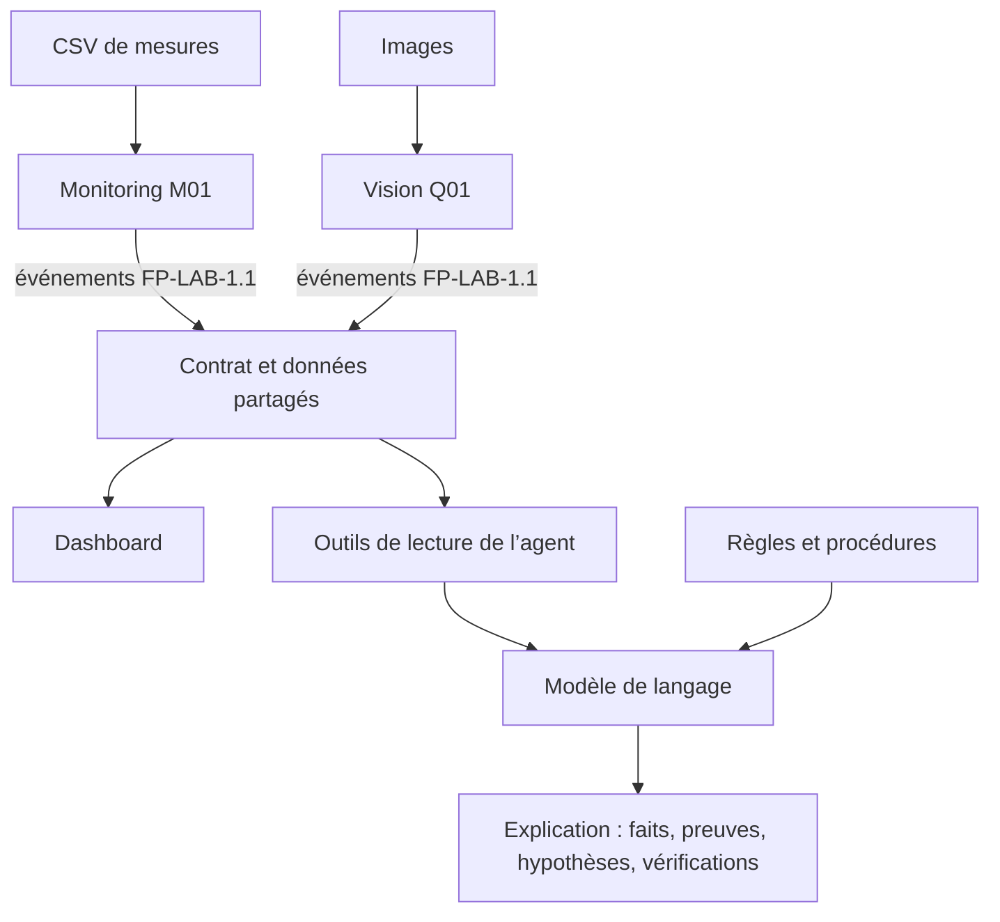
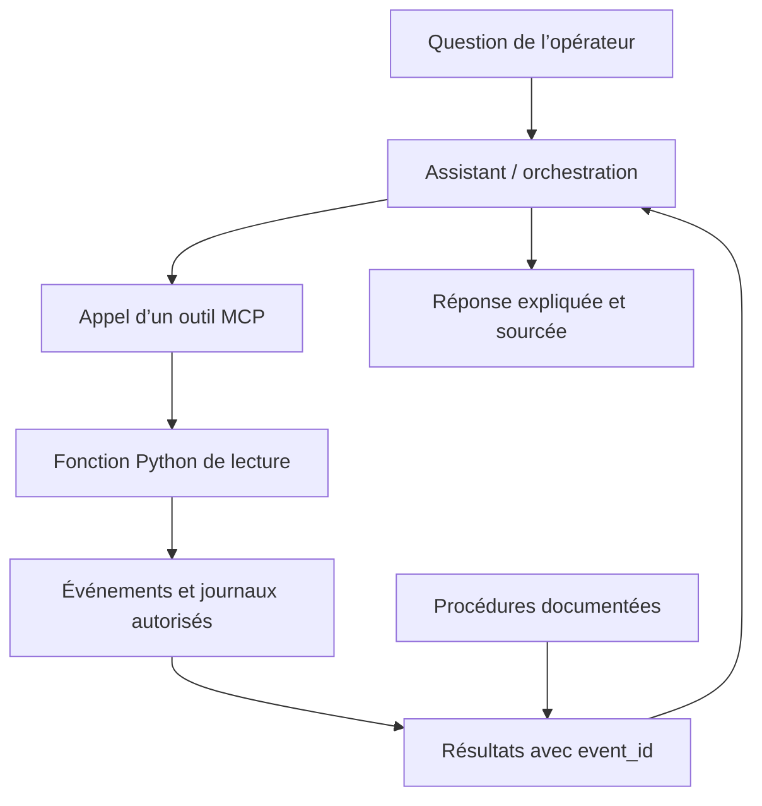
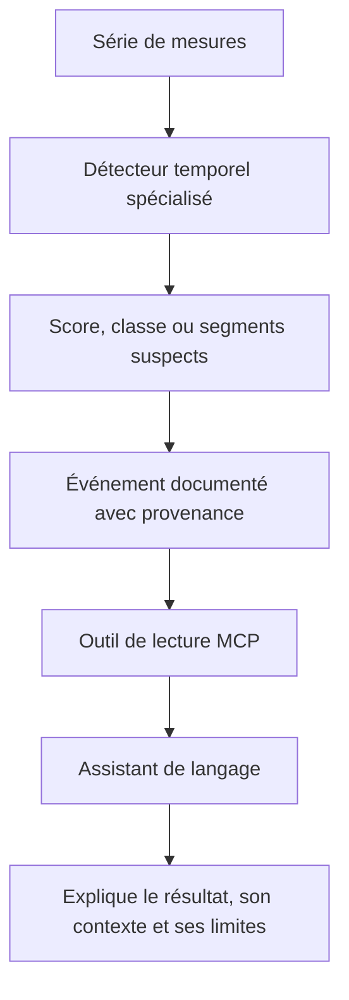
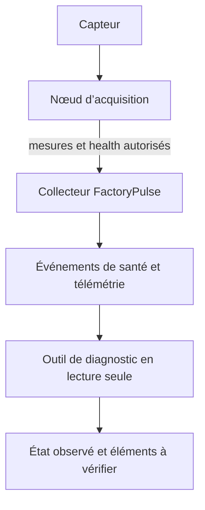
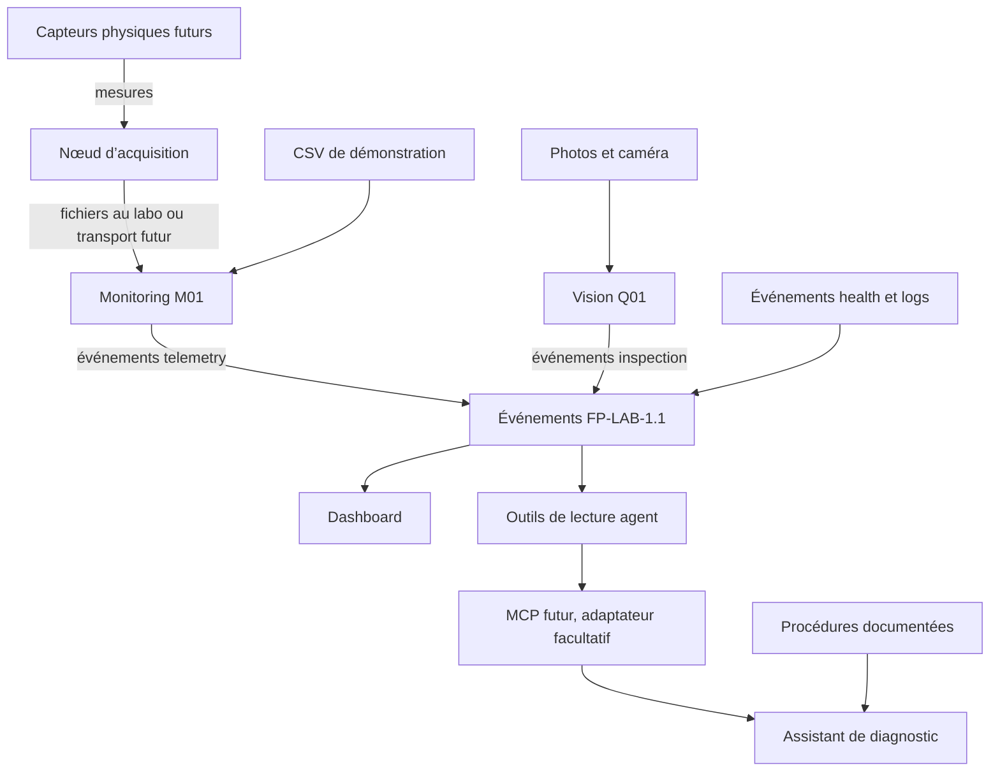
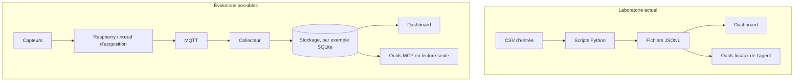

# Explication de l’agent FactoryPulse

## À quoi sert l’agent dans le projet ?

FactoryPulse contient plusieurs modules qui produisent ou présentent des données. L’agent est **transversal** : il peut consulter les sorties de ces modules et aider une personne à comprendre une situation, sans remplacer le travail de chaque équipe.

Le rôle de chaque bloc est différent :

- `monitoring` transforme des mesures de machine en événements de télémétrie et applique ses règles déterministes.
- `vision` transforme des images en événements d’inspection.
- `shared` définit le format commun FP-LAB-1.1 pour échanger ces résultats.
- Le dashboard présente les données à l’opérateur.
- L’agent consulte des événements et des procédures, puis aide à expliquer ce qui est observé.

Par exemple, à la question « Pourquoi M01 est-elle en alerte ? », un outil peut lire l’historique et les journaux. L’assistant peut ensuite résumer les faits, citer les `event_id` qui les prouvent et séparer les hypothèses des vérifications à effectuer.

## L’agent est-il entraîné ?

Dans l’architecture actuelle, **l’agent n’est pas un modèle de détection de séries temporelles entraîné sur les mesures M01**. Les fonctions Python de l’agent sont des outils de lecture en local. MCP est un protocole qui peut exposer ces outils à un assistant; MCP ne constitue pas, à lui seul, un modèle entraîné.

Si un modèle de langage est utilisé pour formuler les réponses, il apporte une capacité générale de compréhension du langage. Il peut recevoir le contexte récupéré par les outils et les procédures pertinentes. Cette approche ressemble à du **RAG** (génération augmentée par récupération) lorsque le système récupère des données ou des documents avant de répondre. Les données du projet ne servent pas automatiquement à entraîner ce modèle.

Le terme RAG décrit surtout le schéma « récupérer du contexte, puis générer une réponse ». Il ne signifie pas nécessairement qu’un modèle spécialisé a été entraîné sur les séries de FactoryPulse. Le dépôt prévoit d’abord des fonctions Python locales; le serveur MCP est une extension ultérieure.

## Pourquoi ne pas entraîner directement un modèle de séries temporelles ?

Un modèle entraîné peut être utile, mais il répond à une question différente : **reconnaître des motifs dans des séquences numériques**, par exemple une dérive ou une anomalie qui n’est pas couverte par un seuil simple.

Pour l’entraîner et l’évaluer correctement, il faut notamment :

- suffisamment de séries représentatives des régimes normaux et anormaux;
- des exemples annotés de manière fiable, avec les conditions de fonctionnement;
- une séparation rigoureuse entre données d’entraînement et de validation;
- des métriques qui montrent ses erreurs, y compris les fausses alertes et les anomalies manquées;
- une surveillance de sa performance lorsque les capteurs, les machines ou les régimes changent.

Le jeu actuel est pédagogique et synthétique. Il ne démontre pas qu’il contient des exemples réels, nombreux et étiquetés pour entraîner un détecteur fiable. Les seuils connus, comme température supérieure à 60 °C selon les règles M01 du labo, sont donc d’abord appliqués par des règles déterministes, faciles à expliquer et à tester. Un seuil franchi signale une condition à examiner; il ne prouve pas à lui seul une panne.

Cette combinaison est une piste d’évolution : le détecteur spécialisé repère des motifs numériques; l’agent explique ses sorties en les reliant à l’historique, aux journaux et aux procédures. L’agent ne devrait pas inventer le score ni transformer une sortie incertaine en fait établi. Il doit citer les événements d’entrée et indiquer quel modèle ou quelle version a produit le résultat.

## Et la vérification des appareils sur le réseau ?

Un futur outil pourrait afficher des observations de connectivité ou de santé si FactoryPulse reçoit ces informations par un canal explicitement configuré et autorisé. Par exemple, les événements `health` peuvent indiquer l’état du service, un horodatage et l’observation de la connexion MQTT à cet instant.

Il faut distinguer une observation enregistrée d’une inspection directe du réseau. Dans la version actuelle, il n’y a pas d’outil MCP qui parcourt le réseau ou vérifie tous les appareils. Un `mqtt_connected` vrai signifie que la connexion était observée comme active au moment de l’événement; cela ne prouve pas qu’elle l’est encore.

Toute extension réseau devrait être limitée à des nœuds connus et à des données de santé explicitement autorisées. L’agent doit rester en lecture seule : pas de scan général du réseau, de connexion SSH, de commande shell, de redémarrage ou de commande machine. Une donnée absente ne permet pas à elle seule de conclure que le capteur ou le Raspberry est débranché.

## Ce qui existe et ce qui reste une piste

| Capacité | État dans le projet |
|---|---|
| Événements M01, Q01, health et logs au contrat commun | Définis dans le contrat et illustrés par des fixtures synthétiques |
| Fonctions Python locales de l’agent | En cours d’implémentation dans `agent/tools.py` |
| Serveur MCP | Non implémenté dans le kit |
| Modèle de détection de séries temporelles entraîné | Non fourni par le kit |
| Explication assistée par un modèle de langage/RAG | Architecture possible, dépend de l’assistant et de ses connexions |
| Vérification directe des appareils sur le réseau | Non implémentée; nécessite une source de santé autorisée |

## Résumé

L’agent est la couche qui **consulte et relie** les informations produites par les autres modules. Les règles et détecteurs déterministes établissent les observations; un éventuel modèle temporel peut repérer des motifs; MCP peut exposer les fonctions de lecture; un modèle de langage peut expliquer le contexte récupéré. Ces rôles peuvent collaborer, mais ils ne sont pas interchangeables. Dans FactoryPulse, l’objectif actuel est un diagnostic explicable, fondé sur les données disponibles et leurs preuves, sans commande sur les machines.

## Travail du groupe et rôle de chaque partie

Le dépôt répartit le projet entre trois équipes métier et un atelier transversal. Si votre enseignant vous a attribué une répartition différente, suivez la répartition de classe.

| Partie | Travail principal | Entrées | Résultats |
|---|---|---|---|
| Équipe 1 — `monitoring` | Lire les mesures M01, calculer ou vérifier les indicateurs, appliquer les règles déterministes et traiter les mesures manquantes | CSV de mesures; plus tard, capteurs via un nœud d’acquisition | Événements de télémétrie M01 en JSONL |
| Équipe 2 — `vision` | Analyser les images de Q01 et décider PASS, REJECT ou UNKNOWN selon les observations disponibles | Images et manifeste d’inspection | Événements d’inspection Q01 en JSONL |
| Équipe 3 — `dashboard` et intégration | Afficher les événements, l’historique, les alertes et les inspections; intégrer les sorties des équipes | Événements au format partagé | Interface destinée à l’opérateur |
| Atelier transversal — `agent` | Lire des événements et procédures, puis fournir une explication consultative avec des preuves et des limites | Événements autorisés, journaux et procédures | Faits, hypothèses conditionnelles et vérifications possibles |

L’agent ne remplace donc ni le détecteur de `monitoring`, ni l’analyse d’images de `vision`, ni le dashboard. Il se place au-dessus de leurs résultats pour aider à les interpréter.

## Comment les blocs sont reliés ?

Le format d’échange actuel est l’événement JSONL au contrat FP-LAB-1.1. Chaque événement contient les six champs communs — `event_id`, `timestamp_utc`, `station_id`, `event_type`, `source` et `payload` — puis les données propres à son type dans `payload`.

Dans le labo actuel, les entrées et échanges s’appuient surtout sur des fichiers : les CSV sont des entrées brutes; les JSONL représentent les événements produits ou les fixtures synthétiques. Les fonctions locales de l’agent lisent ces fichiers autorisés. Le dashboard et l’agent peuvent ainsi s’appuyer sur le même contrat sans importer la logique interne de `monitoring` ou de `vision`.

### Où sont la base de données et le transport ?

Une base de données n’est pas nécessaire au flux de départ et n’est pas le mécanisme central fourni dans le kit. Les fichiers CSV et JSONL servent de stockage et d’échange pour le laboratoire. SQLite est évoquée comme évolution possible dans la présentation du projet, mais cette étape reste à réaliser.

De même, MQTT est prévu comme transport futur entre les nœuds de collecte et un collecteur. Il transporterait les événements; il ne remplace ni les règles de détection, ni le contrat de données, ni le stockage. Le flux réseau et le serveur MCP ne sont pas encore implémentés dans le kit.

Les deux zones du schéma représentent des étapes différentes : les composants du futur ne doivent pas être compris comme déjà connectés ou opérationnels.

### Quel est le rôle des capteurs et des appareils réseau ?

Dans la phase matérielle envisagée, un capteur fournit une mesure à un nœud d’acquisition, par exemple un Raspberry Pi. Le nœud peut publier ou enregistrer des événements de télémétrie et de santé. Le collecteur les rend disponibles aux consommateurs comme le dashboard et les outils de diagnostic.

L’agent ne devrait pas chercher librement tous les appareils du réseau. Pour indiquer qu’un service ou une connexion était actif, il peut consulter un événement `health` daté, par exemple avec `service_state` et `mqtt_connected`. Cette observation décrit l’instant de l’événement; elle ne garantit pas l’état actuel et ne prouve pas, à elle seule, qu’un capteur est physiquement branché.

Le périmètre de l’agent reste la consultation en lecture seule des sources autorisées. Un diagnostic peut signaler qu’une donnée manque ou qu’un signe de vie est périmé et proposer des vérifications humaines. Il ne scanne pas le réseau, n’ouvre pas de session SSH et n’envoie pas de commande à un Raspberry, un capteur ou une machine.
